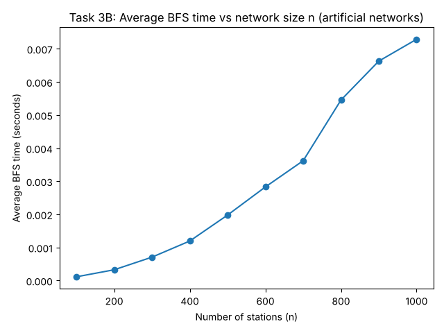
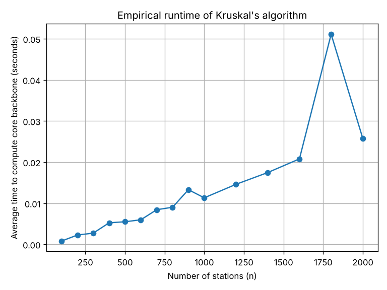

# London Underground Journey Planner

Graph algorithms and data structures applied to the real London Underground network in Python: station status lookups with a hash table, fastest journeys with Dijkstra's algorithm, fewest-stops journeys with breadth-first search (BFS), and the network's "core backbone" with Kruskal's minimum spanning tree algorithm.

Built for **COMP1828 Designing, Developing and Testing Solutions** at the University of Greenwich. This was a group project in which members worked on different subtasks. This repository contains **my four subtasks: 1(a), 2(a), 3(b) and 4(b)**.

All algorithms use the Python implementations from *Introduction to Algorithms* (CLRS, 4th edition), as required by the coursework.

## My subtasks

| Script | Subtask | What it does |
|--------|---------|--------------|
| `task1a_hash_table.py` | 1(a) | Station status system using a hash table with chaining (h(key) = sum of ASCII values mod 7), verified against a hand-traced version |
| `task2a_dijkstra.py` | 2(a) | Fastest journey on a small 5-station network using Dijkstra's algorithm, verified against a manual trace |
| `task3b_bfs.py` | 3(b) | Fewest-stops journey planner using BFS: runtime benchmark on generated networks, then real Tube journeys |
| `task4b_kruskal_empirical.py` | 4(b) | Runtime benchmark of Kruskal's algorithm on generated networks of 100–2,000 stations |
| `task4b_london_backbone.py` | 4(b) | Finds the Tube's core backbone with Kruskal's algorithm and measures the impact of closing redundant connections |

## Results

**Fastest vs fewest stops (Wimbledon → Stratford)**

| Planner | Algorithm | Result |
|---------|-----------|--------|
| Fastest journey | Dijkstra | 50 minutes |
| Fewest stops | BFS | 20 stops |
| Fastest journey on the core backbone only | Kruskal + Dijkstra | 62 minutes (**12 minutes slower**) |

The core backbone (minimum spanning tree) keeps every station connected using the smallest total journey time (649 minutes across all connections), but removing the redundant connections makes some journeys noticeably longer.

**BFS runtime**

BFS runs in Θ(V + E). The test networks add each possible connection with a fixed 5% probability, so the number of connections grows roughly with n², and the runtime grows accordingly.



**Kruskal runtime**

Kruskal's algorithm runs in O(E log V). The test networks have about 3n connections, so the expected growth is O(n log n).



## Running the code

```bash
pip install -r requirements.txt

python task1a_hash_table.py
python task2a_dijkstra.py
python task3b_bfs.py
python task4b_kruskal_empirical.py
python task4b_london_backbone.py
```

Run the scripts from inside this folder, so they can find the data file and the CLRS library.

## Project structure

```
├── task*.py                        My subtask scripts
├── London Underground data.xlsx    Tube connections and journey times (provided with the coursework)
├── clrsPython.py                   CLRS library: graphs, Dijkstra, Kruskal (used by 2(a) and 4(b))
├── clrs/                           CLRS library: hash table, BFS, linked list, queue (used by 1(a) and 3(b))
└── images/                         Runtime charts
```

## Credits

The CLRS Python library was written by Linda Xiao and Tom Cormen for *Introduction to Algorithms*, Fourth edition (Cormen, Leiserson, Rivest and Stein), and is used under the MIT License included in each file.
